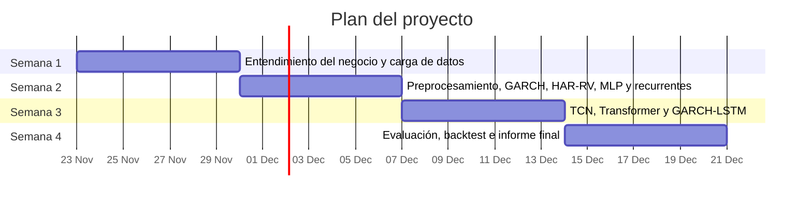

# Project Charter - Entendimiento del Negocio

## Nombre del Proyecto

Pronóstico de la volatilidad del petróleo WTI y Brent con Deep Learning

## Objetivo del Proyecto

Pronosticar la volatilidad realizada del barril de petróleo WTI y Brent a 1, 5 y 22 días hábiles, y evaluar si los modelos de Deep Learning mejoran a las referencias econométricas estándar (GARCH y HAR-RV).

**Trasfondo del negocio.** El proyecto está enmarcado en el área de finanzas de energía. Su principal beneficiario es la mesa de riesgo de una empresa productora y comercializadora de crudo. La empresa mantiene una exposición permanente al precio del petróleo. Por ejemplo, un millón de barriles de producción o inventario sin cubrir, que a USD 80 por barril equivalen a USD 80 millones expuestos a las variaciones del mercado [1].

Cada día la mesa decide cuánta de esa exposición cubrir con contratos de futuros de WTI y Brent, y qué límite de pérdida fijar (por ejemplo, un VaR al 95%) para un horizonte de 1 a 22 días hábiles [2]. Ambas decisiones dependen de cuánta volatilidad se espera. La volatilidad mide qué tan amplio es el rango de movimientos posibles del precio y no da información sobre su dirección.

**Por qué es importante.** La volatilidad del petróleo cambia con el tiempo. Se agrupa en episodios de calma y de turbulencia (2008, 2014 a 2016, abril de 2020 y 2022) y tiene colas pesadas, es decir, días extremos más frecuentes de lo que sugiere una distribución normal. Si la mesa subestima la volatilidad, su límite de pérdida queda corto, una pérdida que se creía excepcional se vuelve frecuente y la cobertura resulta insuficiente. Si la sobreestima, cubre de más, inmoviliza capital en garantías y renuncia a ingresos que el negocio quería capturar. Los modelos econométricos GARCH y HAR-RV son hoy la referencia estándar para este pronóstico, y el proyecto evalúa si el Deep Learning logra mejorarlos [3].

## Alcance del Proyecto

### Incluye:

- **Datos disponibles:** series de tiempo financieras públicas desde 2007: precios spot diarios de WTI y Brent (FRED), futuros continuos de WTI y Brent con apertura, máximo, mínimo y cierre, índices de volatilidad implícita OVX y VIX (Yahoo Finance) e inventarios semanales de crudo de EE.UU. (EIA). Se obtienen por API con un proceso reproducible que actualiza los datos en cada ejecución. El detalle está en [`docs/data/data_definition.md`](../data/data_definition.md).
- **Resultados esperados:** un conjunto de modelos de series de tiempo que pronostican la volatilidad realizada a 1, 5 y 22 días hábiles: perceptrón multicapa (MLP), redes recurrentes (LSTM y GRU), una red convolucional temporal (TCN), un Transformer encoder y un modelo híbrido GARCH-LSTM, comparados contra GARCH y HAR-RV. El conjunto final de arquitecturas se confirma en la semana 3 según los resultados preliminares.
- **Uso por parte del beneficiario:** la mesa de riesgo recibiría cada día la volatilidad esperada a cada horizonte y la usaría como insumo para recalibrar su VaR y decidir cuánta exposición cubrir con futuros.
- **Entregable:** un prototipo reproducible con descarga automática de datos. La entrega final incluye un backtest que muestra cómo habrían funcionado los pronósticos sobre el histórico.
- **Criterios de éxito del proyecto:**
  - Todos los modelos se evalúan con el mismo esquema de validación walk-forward, sin fuga de información, y con métricas de error de pronóstico y pruebas de significancia estadística frente a GARCH y HAR-RV.
  - El desempeño se analiza por régimen de mercado (calma y turbulencia).
  - El resultado de la comparación queda abierto: si los modelos econométricos superan al Deep Learning, también es un hallazgo válido y se reporta como tal.

### Excluye:

- La implementación en producción del sistema de pronóstico.

## Metodología

El proyecto sigue la metodología TDSP (Team Data Science Process) y se organiza en entregas semanales:

1. A partir de los retornos se construye un objetivo de volatilidad realizada.
2. Los datos se preparan para los modelos de Deep Learning con ventanas de entrada, validación walk-forward y normalización sin fuga de información (divisiones estrictamente cronológicas).
3. Se entrenan los modelos econométricos de referencia (GARCH, HAR-RV) y los modelos de Deep Learning, con varias semillas por modelo.
4. Se comparan con métricas de error de pronóstico y pruebas de significancia estadística, y se analiza su desempeño por régimen de mercado.
5. Se hace un backtest sobre el histórico.

## Cronograma

El proyecto se desarrolla en cuatro semanas, del 23 de noviembre al 20 de diciembre de 2026, con una entrega por semana. Cada semana construye sobre la anterior, y las decisiones de diseño (objetivo de volatilidad, ventanas, divisiones de los datos) se fijan temprano para respetarlas hasta el final. Las horas son estimaciones de dedicación.

| Etapa | Duración Estimada | Fechas |
|------|---------|-------|
| Entendimiento del negocio y carga de datos | 1 semana (~10 h) | del 23 al 29 de noviembre de 2026 |
| Preprocesamiento, modelos de referencia y primeros modelos de DL | 1 semana (~14 h) | del 30 de noviembre al 6 de diciembre de 2026 |
| Modelamiento avanzado | 1 semana (~16 h) | del 7 al 13 de diciembre de 2026 |
| Evaluación y entrega final | 1 semana (~14 h) | del 14 al 20 de diciembre de 2026 |

- **Semana 1. Entendimiento del negocio y carga de datos.** Se define el marco del proyecto, se documentan las fuentes y se escribe el código de conexión por API a FRED, Yahoo Finance y EIA, con una copia local en caché. *Riesgo:* que una fuente falle o cambie su formato; se mitiga con la copia en caché.
- **Semana 2. Preprocesamiento, modelos de referencia y primeros modelos de DL.** Se construye el objetivo de volatilidad, se arman las ventanas de entrada, se normaliza sin fuga de información y se define la validación walk-forward. Se ajustan GARCH y HAR-RV y los primeros modelos de DL (MLP y recurrentes). *Riesgo:* fuga de información entre entrenamiento y prueba; se controla con divisiones estrictamente cronológicas.
- **Semana 3. Modelamiento avanzado.** Se implementan la TCN, el Transformer encoder y el híbrido GARCH-LSTM, se comparan funciones de pérdida y se aplica regularización, con varias semillas por modelo. *Riesgo:* sobreajuste a un solo periodo de mercado.
- **Semana 4. Evaluación y entrega final.** Se comparan todos los modelos con métricas de error y pruebas de significancia estadística, se analiza el desempeño por régimen, se hace el backtest sobre el histórico y se redacta el informe final. *Riesgo:* que los resultados no favorezcan al Deep Learning; es un hallazgo válido que se reporta como tal.

## Equipo del Proyecto

- Erika Katherin Olivera Parrado - Integrante del equipo
- Dario Andres Acero Guerrero - Integrante del equipo
- Jhon Anderson Bermudez Hurtado - Integrante del equipo

## Presupuesto

El proyecto usa únicamente fuentes de datos públicas y herramientas de código abierto, por lo que no tiene costos de licencias ni de datos. Solo requiere los recursos computacionales propios del equipo.

## Stakeholders

- **Mesa de riesgo** de una empresa productora y comercializadora de crudo: beneficiaria principal del proyecto.
- **Relación con los stakeholders:** el proyecto le entrega a la mesa un pronóstico diario de la volatilidad esperada de WTI y Brent a 1, 5 y 22 días hábiles.
- **Expectativas de los stakeholders:** contar con un pronóstico de volatilidad confiable para recalibrar su límite de pérdida (VaR) y decidir cuánta exposición cubrir con futuros, evitando tanto la subestimación (cobertura insuficiente) como la sobreestimación (capital inmovilizado en garantías).

## Aprobaciones

- Erika Katherin Olivera Parrado - Integrante del equipo
- Dario Andres Acero Guerrero - Integrante del equipo
- Jhon Anderson Bermudez Hurtado - Integrante del equipo
- Juan Sebastian Malagon - Tutor de la clase

## Referencias

- [1] Predicción del precio del petróleo mediante el uso de Machine Learning. https://dspace.udla.edu.ec/handle/33000/17911
- [2] Predicción de precios del petróleo WTI a través de modelos autorregresivos integrado de medias móviles (ARIMA) y redes neuronales. https://dialnet.unirioja.es/servlet/articulo?codigo=9952765
- [3] Evolución y perspectivas del precio del petróleo. https://bdigital.upme.gov.co/entities/publication/18a3b2dc-fd22-4c46-bb7d-d16102b11366
- [4] Precio del petróleo Brent y WTI: pronóstico para 2026, 2027, 2028–2030. https://www.litefinance.org/es/blog/analysts-opinions/prevision-petroleo/
- [5] Análisis y predicción del precio del petróleo. Una aproximación basada en modelos ARIMA. https://e-archivo.uc3m.es/rest/api/core/bitstreams/93c2d7d5-f00b-4f54-9c8e-f2846935b73e/content
- [6] Crude oil: Does the futures price predict the spot price? https://www.sciencedirect.com/science/article/abs/pii/S0275531921002324
